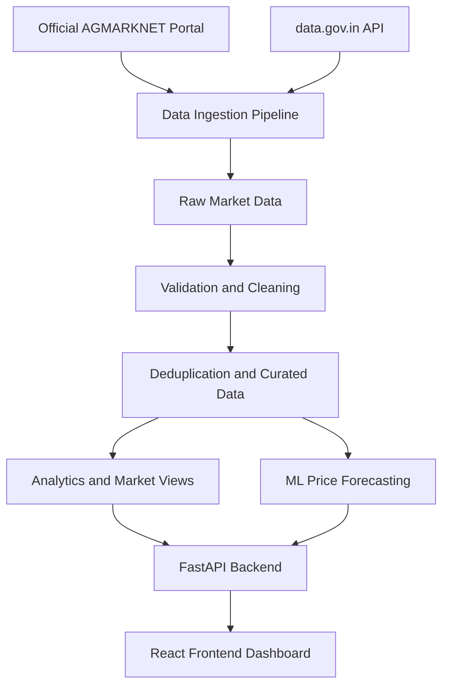

<!-- FarmPrice AI README Banner -->
<p align="center">
  
</p>

# FARMPRICE AI
### Know Your Market. Calculate Your Return. Sell With Confidence.

**FARMPRICE AI** is an agricultural market intelligence and decision-support platform built for Indian farmers. It integrates agricultural market price data, calculates transportation-adjusted net returns, forecasts commodity prices using machine-learning time-series models, and provides explainable mandi recommendations.

---

## 🌾 Key Features

- **Live Market Prices:** Access agricultural market prices from official data sources.
- **Smart Mandi Comparison:** Compare prices across markets and estimate net returns after transportation expenses.
- **Price Forecasting:** Analyze historical trends and generate price forecasts.
- **Crop Intelligence:** Explore commodity prices, varieties, and market arrivals.
- **Data Quality Monitoring:** Identify missing values, duplicate observations, and anomalous prices.
- **Admin Dashboard:** Monitor data synchronization, pipeline health, and analytical metrics.
- **REST API:** Access market data and analytics through FastAPI endpoints.
- **Farmer-Focused Insights:** Make better-informed decisions about where and when to sell.

---

## 1. System Architecture & End-to-End Data Flow

FARMPRICE AI implements an automated data pipeline designed for data validation, deduplication, and reliable market analytics.



### Multi-Layer Data Storage Model

1. **Raw Layer:** Stores source payloads and original records for traceability.
2. **Staging Layer:** Validates dates, numeric fields, price ranges, and units.
3. **Curated Layer:** Deduplicates market observations and maintains standardized crop and mandi references.
4. **Analytics Layer:** Supports price trends, net-return calculations, and market comparisons.

The local SQLite analytical database is available as a fallback when Snowflake is not configured.

---

## 2. Official Data Sources

| Source | URL | Purpose |
|---|---|---|
| data.gov.in AGMARKNET Daily Prices | https://api.data.gov.in/resource/9ef84268-d588-465a-a308-a864a43d0070 | Agricultural market prices |
| AGMARKNET Portal | https://agmarknet.gov.in/home | Official agricultural market information |
| Karnataka Krishi Marata Vahini | https://krishimaratavahini.karnataka.gov.in | Karnataka agricultural market information |

### Market Data Fields

- Observation date
- State and district
- APMC mandi or market
- Commodity and crop variety
- Minimum price
- Maximum price
- Modal price
- Arrival quantity
- Price unit and currency

**Data freshness:** Official market records may be published with a delay of 12–24 hours after market activity. Actual availability depends on the source.

### Data Source Constraints

- Programmatic access to data.gov.in requires an API key.
- When the API is not configured, the application may use its configured local fallback.
- Closed-market days must not be populated with fabricated observations.
- Data freshness should be displayed using the actual observation and synchronization timestamps.

---

## 3. Data Ingestion & Synchronization

The `AgmarknetDataProvider` ingestion pipeline supports:

- Bounded retries with exponential backoff.
- Handling of HTTP 429 and HTTP 5xx errors.
- Idempotent synchronization and duplicate prevention.
- Price-range validation.
- Rejection or quarantine of incomplete records.
- Synchronization batch history and audit logging.
- Historical data backfills.

Synchronization results should report the number of records fetched, inserted, updated, duplicated, and rejected.

---

## 4. REST API Endpoints

### Market & Data Endpoints

| Method | Endpoint | Description |
|---|---|---|
| GET | `/api/market/prices` | Paginated market prices with filters |
| GET | `/api/market/prices/latest` | Latest available prices |
| GET | `/api/market/prices/history` | Historical price trends |
| GET | `/api/market/arrivals` | Commodity arrival volumes |
| GET | `/api/market/commodities` | Registered commodities |
| GET | `/api/market/locations` | Mandi locations and related information |
| GET | `/api/market/comparison` | Mandi comparison and estimated net returns |
| GET | `/api/data/sources` | Data source registry and status |
| GET | `/api/data/freshness` | Data freshness and last synchronization |
| GET | `/api/data/quality` | Data quality checks |

### System Health Endpoints

| Method | Endpoint | Description |
|---|---|---|
| GET | `/api/health` | Application health |
| GET | `/api/health/snowflake` | Snowflake connectivity and latency |

### Protected Administrative Endpoints

| Method | Endpoint | Description |
|---|---|---|
| GET | `/api/admin/metrics` | Administrative metrics |
| GET | `/api/admin/sync-status` | Current synchronization status |
| GET | `/api/admin/sync-history` | Synchronization history |
| POST | `/api/admin/sync-agmarknet` | Trigger an incremental data synchronization |
| POST | `/api/admin/sync-backfill` | Trigger a historical data backfill |

Administrative endpoints must be protected with proper authentication and authorization.

---

## 5. Technology Stack

- **Frontend:** React, Vite, JavaScript
- **Backend:** Python, FastAPI
- **Data Processing:** Python-based ingestion, validation, and analytics
- **Database:** SQLite local analytical fallback
- **Data Warehouse:** Snowflake, when configured
- **Data Sources:** AGMARKNET and data.gov.in
- **Analytics:** Historical price analysis and machine-learning time-series forecasting
- **API Documentation:** FastAPI Swagger UI

> Configure only the technologies and integrations that are actually installed and enabled in your deployment.

---

## 6. Environment Configuration

Create a `.env` file in the project root using the following template.

```env
# Server Configuration
APP_ENV=development
APP_PORT=8000
APP_HOST=0.0.0.0
CORS_ORIGINS=http://localhost:5173,http://localhost:3000

# Government Market Data API
DATA_GOV_IN_API_KEY=your_data_gov_in_api_key
DATA_GOV_IN_BASE_URL=https://api.data.gov.in/resource/9ef84268-d588-465a-a308-a864a43d0070
SYNC_INTERVAL_MINUTES=60

# Snowflake Configuration
SNOWFLAKE_USE_LOCAL_FALLBACK=true
SNOWFLAKE_ACCOUNT=your_snowflake_account_identifier
SNOWFLAKE_USER=your_snowflake_username
SNOWFLAKE_PASSWORD=your_snowflake_password
SNOWFLAKE_WAREHOUSE=COMPUTE_WH
SNOWFLAKE_DATABASE=FARMPRICE_DB
SNOWFLAKE_SCHEMA=ANALYTICS
SNOWFLAKE_ROLE=your_snowflake_role

# Cost Assumptions
DEFAULT_TRANSPORT_PER_KM_PER_QUINTAL=0.85
DEFAULT_LOADING_UNLOADING_PER_QUINTAL=8.0
DEFAULT_MARKET_CESS_PERCENT=1.5
```

### Security Guidelines

- Never commit `.env` files to GitHub.
- Never expose private API keys or database passwords in frontend code.
- Configure production CORS origins explicitly.
- Protect administrative APIs.
- Use environment variables or your hosting provider's secret-management facility.
- Ensure the displayed data source and freshness status accurately reflect the actual backend state.

When `SNOWFLAKE_USE_LOCAL_FALLBACK=true`, the application is intended to use the local SQLite analytical mirror, `farmprice_local.db`, according to the backend configuration.

---

## 7. Local Setup & Execution

### Prerequisites

- Python installed
- Node.js and npm installed
- Git installed

### Backend Setup

From the project root, run:

```bash
python -m pip install -r backend/requirements.txt
```

Run the automated test suite:

```bash
python -m pytest tests/
```

Start the backend:

```bash
python backend/run.py
```

Backend URL:

`http://localhost:8000`

Swagger API documentation:

`http://localhost:8000/docs`

### Frontend Setup

Open a new terminal:

```bash
cd frontend
npm install
npm run build
npm run dev
```

Frontend development URL:

`http://localhost:5173`

Run the commands from the directories that match your actual repository structure.

---

## 8. Historical Market Data Backfill

Example request for an authorized historical backfill:

```bash
curl -X POST http://localhost:8000/api/admin/sync-backfill \
  -H "Content-Type: application/json" \
  -d "{\"start_date\":\"2026-10-01\",\"end_date\":\"2026-10-24\",\"commodity\":\"Tomato\",\"state\":\"Karnataka\",\"batch_size\":50}"
```

The request must satisfy the backend's authentication and validation requirements. The example dates are illustrative and should be changed to the period you need.

---

## 9. Smart Mandi & Net Return Calculation

FARMPRICE AI helps farmers compare markets using estimated net returns.

A basic calculation is:

**Estimated Net Return = Expected Sale Value − Transportation Costs − Loading/Unloading Costs − Applicable Market Charges**

The result depends on the farmer's crop quantity, available market prices, distance, freight assumptions, and applicable fees.

Market comparisons should clearly distinguish:

- Officially observed modal prices
- User-provided transportation estimates
- Calculated deductions
- Estimated net returns
- Forecasts and uncertainty

Price forecasts are estimates, not guarantees of future auction prices.

---

## 10. Testing & Quality Assurance

Run the backend tests:

```bash
python -m pytest tests/
```

Build the frontend:

```bash
cd frontend
npm run build
```

Before deployment, verify:

- API connectivity
- Database connectivity
- Market price freshness
- Data validation and deduplication
- Mandi comparison calculations
- Forecast output and error handling
- Authentication and protected administrative routes
- Responsive frontend behavior
- Environment variables and production configuration

Only report test counts and test results that have been verified against the current project.

---

## 11. Deployment

The application can be deployed using hosting platforms that support its frontend and backend requirements.

A typical deployment consists of:

1. Deploy the React frontend.
2. Deploy the FastAPI backend on a Python-compatible hosting service.
3. Configure production environment variables.
4. Set the frontend's backend API base URL.
5. Configure CORS for the deployed frontend domain.
6. Configure the production database or warehouse.
7. Verify health checks, data freshness, and synchronization.
8. Test the deployed application end to end.

**Important:** A frontend deployment alone does not run the Python backend or scheduled data ingestion. Deploy and configure both components where required.

---

## 12. Licensing & Attribution

- **Primary data sources:** Directorate of Marketing & Inspection (DMI), Ministry of Agriculture and Farmers Welfare, Government of India, through AGMARKNET and data.gov.in.
- **Open data license:** [Government Open Data License – India](https://data.gov.in/godl).
- **AGMARKNET:** [Official Portal](https://agmarknet.gov.in/home).

### Disclaimer

Market prices represent observations reported by the relevant market committees. Transportation deductions and net returns are estimates based on configured assumptions and user inputs. Historical prices and machine-learning forecasts do not guarantee future market prices or sale proceeds.

---

<p align="center">
  <strong>FARMPRICE AI</strong><br>
  Predict • Compare • Get Better Prices
</p>
