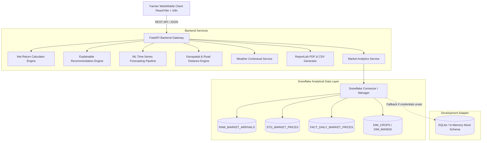

# FARMPRICE AI — Architecture & Technical Design

## 1. System Overview

FARMPRICE AI is architected as a decoupled, production-ready system with a modern Single Page Application (SPA) frontend, a high-performance Python FastAPI service layer, and a Snowflake analytical warehouse data layer.

## 2. Snowflake Analytics Architecture

The Snowflake data warehouse is modeled according to modern data engineering best practices:

1. **Raw Ingestion Layer (`RAW_MARKET_ARRIVALS`):**
   - Stores raw payload records from Agmarknet / data.gov.in schemas without transformation.
   - Retains ingestion timestamps, raw price units, and source file identifiers.

2. **Staging & Cleaning Layer (`STG_MARKET_PRICES`):**
   - Validates data types, currency symbols, and unit conversions (Rs/Quintal).
   - Eliminates duplicate observations for identical `(mandi_id, crop_id, variety_id, arrival_date)`.
   - Flags anomalies (e.g. Min price > Max price, zero prices, future dates).

3. **Curated Dimensional Analytical Layer:**
   - `DIM_CROPS` & `DIM_VARIETIES`: Standardized crop classifications.
   - `DIM_MANDIS` & `DIM_GEOGRAPHY`: APMC mandi metadata, latitude/longitude, district, state.
   - `FACT_DAILY_MARKET_PRICES`: Daily aggregated metrics (min_price, modal_price, max_price, arrival_tonnes, quality_status).
   - `DATA_QUALITY_AUDIT`: Log of staleness checks, null values, and observation counts.
   - `FORECAST_EVALUATION_METRICS`: Historical model metrics (MAE, RMSE, MAPE) by crop-mandi combination.

## 3. Mathematical & Deterministic Net Return Formulation

The calculation engine is entirely deterministic and mathematically verifiable:

$$\text{Gross Value} = Q \times P_{\text{modal}}$$

$$\text{Transport Cost} = \begin{cases} 
C_{\text{transport\_custom}} & \text{if explicitly specified} \\
D_{\text{road}} \times R_{\text{rate\_per\_km\_quintal}} \times Q & \text{otherwise}
\end{cases}$$

$$\text{Market Fees} = \text{Gross Value} \times \left(\frac{\text{Cess \%}}{100}\right)$$

$$\text{Total Selling Expenses} = \text{Transport} + \text{Loading/Unloading} + \text{Market Fees} + \text{Other}$$

$$\text{Net Return} = \text{Gross Value} - \text{Total Selling Expenses}$$

$$\text{Net Return per Quintal} = \frac{\text{Net Return}}{Q}$$

$$\text{Break-Even Price per Quintal} = \frac{\text{Total Selling Expenses}}{Q}$$

*(Or if farm gate production cost $C_{\text{prod}}$ is supplied: $\text{Break-Even} = \frac{\text{Total Expenses} + (Q \times C_{\text{prod}})}{Q}$)*

## 4. Explainable Recommendation Rules

The decision engine ranks candidate markets using deterministic rules:
1. **Primary Metric:** Highest Estimated Net Return ($\text{Net Return} = \text{Gross} - \text{Total Costs}$).
2. **Tie-Breaker 1:** Higher Crop Arrival Volume (indicates deeper market liquidity and lower risk of price collapse on arrival).
3. **Tie-Breaker 2:** Shorter Road Distance (reduces transit spoilage risk and travel time).
4. **Tie-Breaker 3:** Fresher Observation Date.

Every recommendation output provides an explicit textual explanation decomposing:
- **Price Advantage:** "Modal price is ₹X/q higher/lower than nearest market."
- **Distance Impact:** "Road distance of Y km adds ₹Z in transportation expenses."
- **Net Gain:** "Generates ₹W (+P%) higher net profit than Market B."
- **Data Freshness & Reliability:** "Observed on [Date] with Verified Agmarknet records."

## 5. AI Time-Series Forecasting Pipeline

- **Chronological Split:** Splits historical series temporally (e.g. 80% train, 20% holdout). No random shuffle.
- **Model:** Auto-regressive Ridge/Linear time series model with 7-day, 14-day lag features, rolling moving averages, day-of-week seasonality, and trend components.
- **Baseline Model:** 7-day Simple Moving Average (SMA) baseline.
- **Evaluation:** MAE (Mean Absolute Error), RMSE (Root Mean Squared Error), and MAPE (Mean Absolute Percentage Error) computed and returned alongside predictions.
- **Prediction Interval:** $\hat{y} \pm 1.96 \times \sigma_{\text{residuals}}$ for 95% confidence bands.
- **Data Sufficiency Guard:** If a crop-mandi series has fewer than 14 valid historical observations, the endpoint returns an explicit status `INSUFFICIENT_DATA` rather than hallucinating prices.
